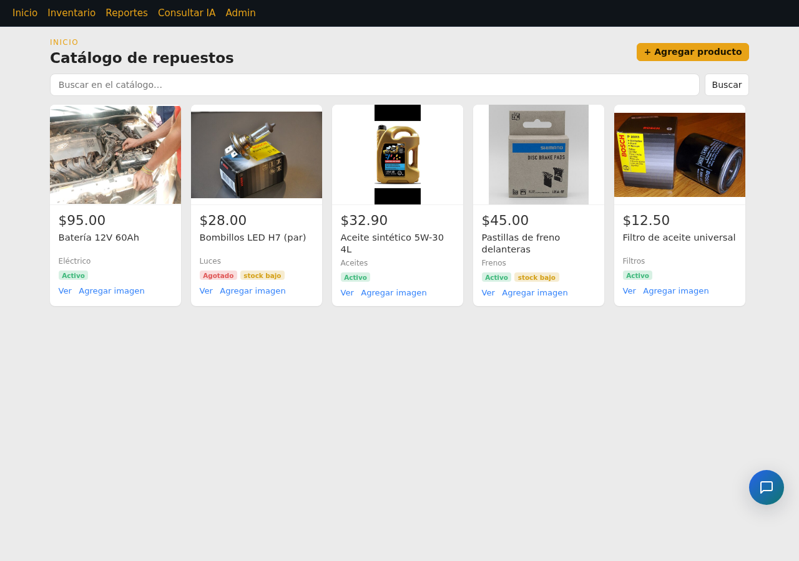
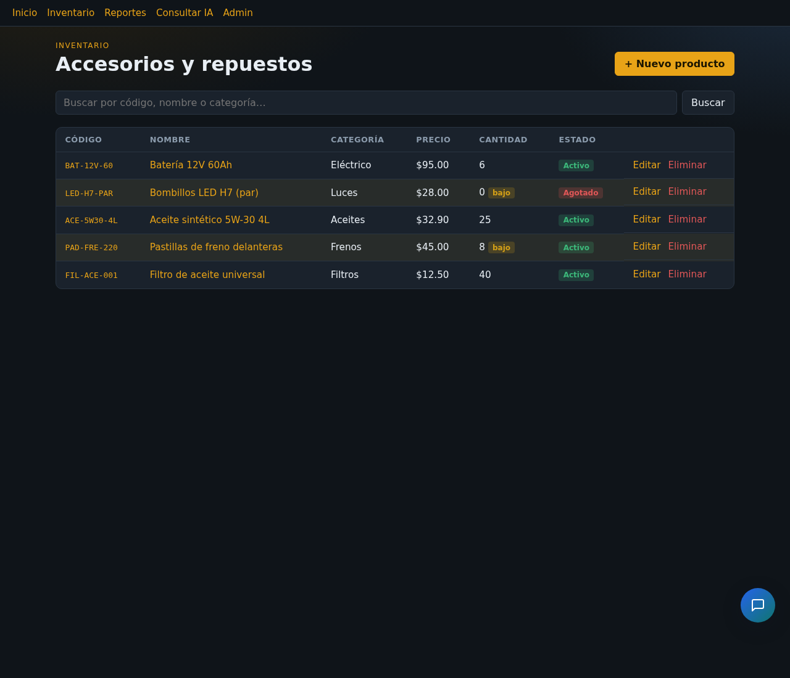
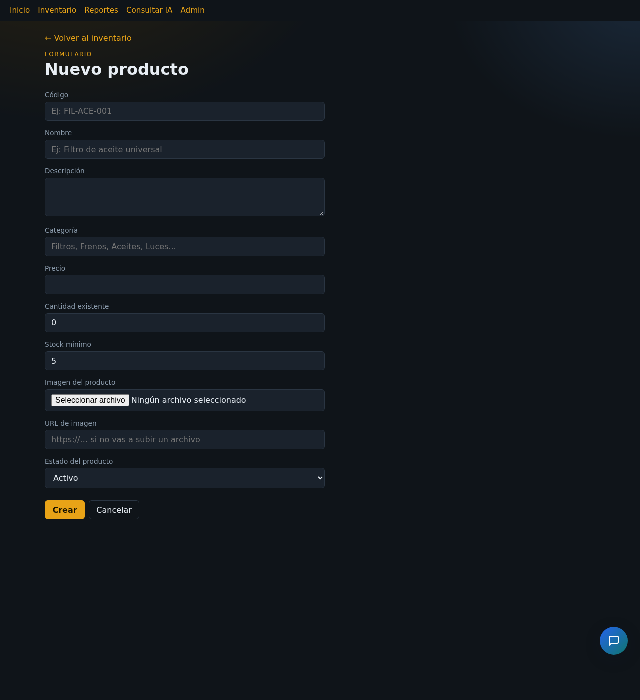
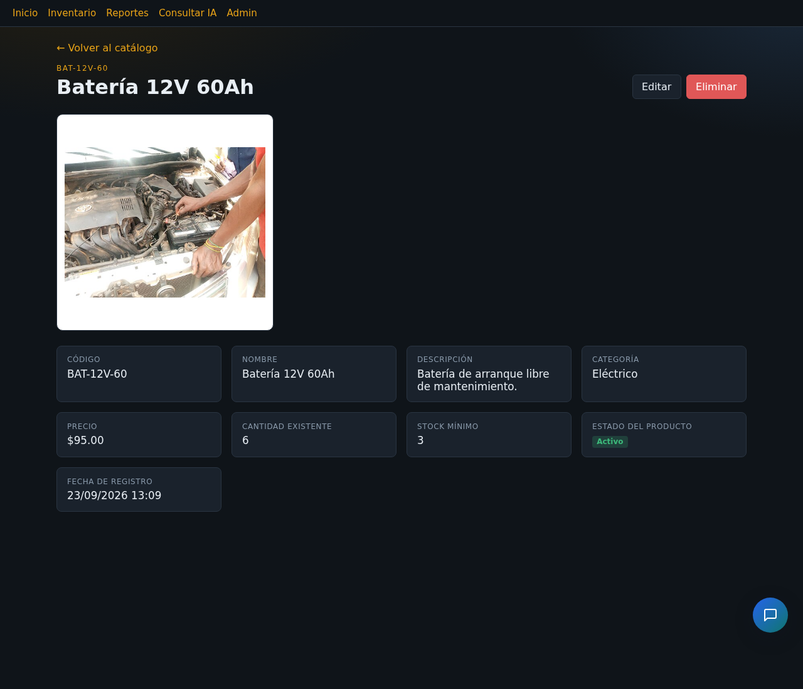
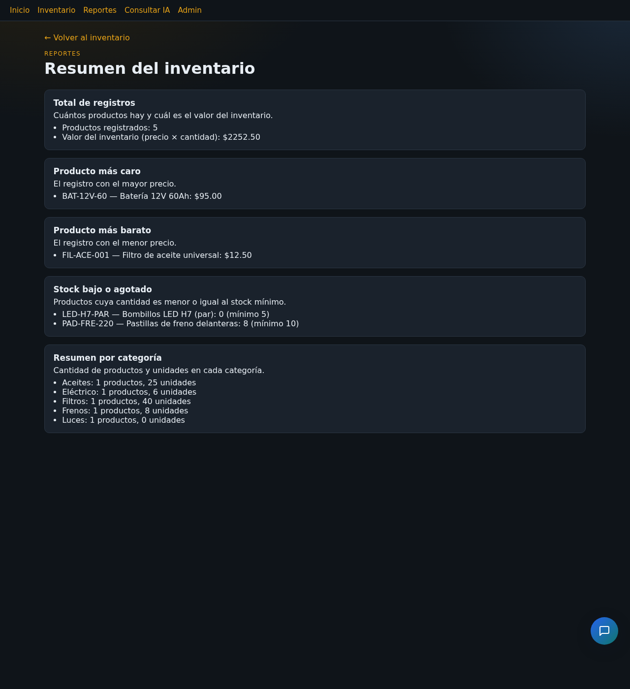
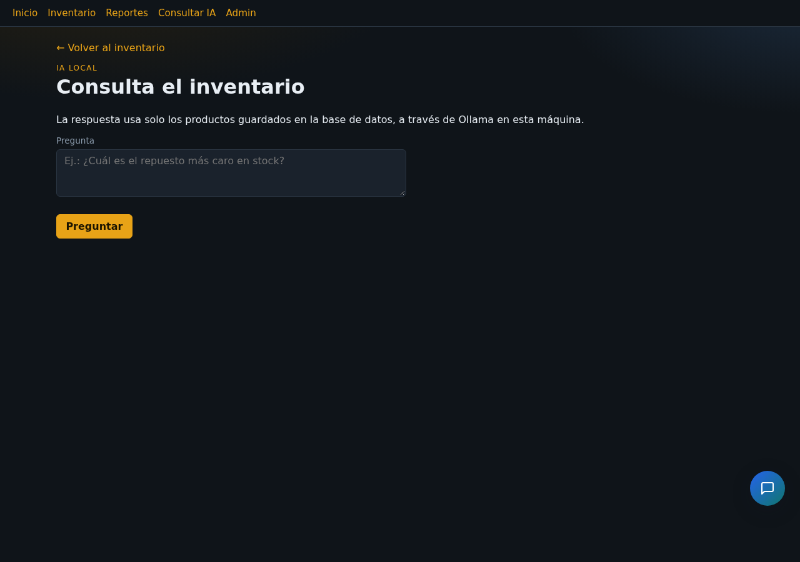

# Sistema de inventario con CRUD e inteligencia artificial local

Felipe Gabriel Albani

Programación IV

Jared Lopez Leaños

29 de septiembre de 2026

---

## Resumen

El sistema administra repuestos y accesorios de AutoRepuestos. La app `tienda`
guarda los productos en SQLite, ofrece el CRUD completo, cinco reportes y un
formulario que consulta a Ollama usando solo las filas reales de la base de
datos. El trabajo parte de la actividad 5 (28 de septiembre de 2026) y cierra
los requisitos del entregable final: respuesta que no cite códigos ajenos al
catálogo, dependencias portables, informe y evidencias de la asistencia de
codificación.

El servidor se levanta con `python manage.py runserver 0.0.0.0:8000`. La raíz
redirige al catálogo (`/tienda/catalogo/`). Las capturas de esta entrega están
en la carpeta `capturas/`.

---

## Punto 1. Diseño e implementación del CRUD

### 1.1 Modelo de datos

La entidad es **Producto**. El identificador único es `codigo`. Hay más de seis
campos de negocio.

| Campo | Tipo | Regla |
|-------|------|--------|
| codigo | CharField, unique | Obligatorio. Se guarda en mayúsculas. |
| nombre | CharField | Obligatorio. |
| descripcion | TextField | Opcional. |
| categoria | CharField | Obligatoria. |
| precio | DecimalField | Obligatorio y no negativo. |
| cantidad | PositiveIntegerField | No negativa. |
| stock_minimo | PositiveIntegerField | No negativa. |
| estado | activo / inactivo / agotado | Si la cantidad llega a 0 estando activo, pasa a agotado. |
| fecha_registro | DateTimeField | Se asigna al crear. |

El inicio del sitio es el catálogo (`/tienda/catalogo/`). Ahí cada producto se
ve como una tarjeta, con foto, precio y estado. La foto puede ser un archivo
subido (`imagen`) o un enlace (`imagen_url`, migración `0002`). Si hay las
dos, se muestra el archivo. Alta y edición piden ambos en el formulario.

```python
codigo = models.CharField("Código", max_length=40, unique=True)
nombre = models.CharField("Nombre", max_length=200)
precio = models.DecimalField("Precio", max_digits=12, decimal_places=2)
cantidad = models.PositiveIntegerField("Cantidad existente", default=0)
```

### 1.2 Migraciones y administración

Migraciones: `tienda/migrations/0001_initial.py` y
`0002_producto_imagen_url.py`.

```bash
python manage.py makemigrations tienda
python manage.py migrate
python manage.py seed_productos
python manage.py runserver 0.0.0.0:8000
```

Salida actual de `makemigrations`: `No changes detected in app 'tienda'`. Las
migraciones ya están aplicadas. `seed_productos` dejó 5 productos.

```python
class ProductoAdmin(admin.ModelAdmin):
    list_display = (
        "codigo", "nombre", "categoria", "precio",
        "cantidad", "stock_minimo", "estado", "fecha_registro",
    )
    list_filter = ("estado", "categoria")
    search_fields = ("codigo", "nombre", "categoria")
```

El panel está en `tienda/admin.py` (`list_display`, filtro por estado y
categoría, búsqueda por código, nombre y categoría). Se abre en
`/django-admin/`. El admin de Wagtail sigue en `/admin/`.

La pila real es Django 6.1 con Wagtail 8, porque el proyecto base lo exige.
La consigna menciona Django 5.x; no se bajó la versión para no romper Wagtail.
La app `tienda` usa el ORM, las vistas genéricas y los formularios de Django
sobre SQLite.

### 1.3 Vistas, validaciones y mensajes

| Operación | URL |
|-----------|-----|
| Entrada del sitio | `/` (redirige a `/tienda/catalogo/`) |
| Lista y búsqueda | `/tienda/` |
| Detalle | `/tienda/<id>/` |
| Crear | `/tienda/nuevo/` |
| Editar | `/tienda/<id>/editar/` |
| Eliminar | `/tienda/<id>/eliminar/` |

`ProductoForm.clean_codigo` rechaza el código vacío y el duplicado, sin
distinguir mayúsculas. `clean_precio`, `clean_cantidad` y `clean_stock_minimo`
rechazan valores negativos. Nombre y categoría son obligatorios. Crear, editar
y eliminar muestran un mensaje de éxito.

```python
def clean_codigo(self):
    codigo = (self.cleaned_data.get("codigo") or "").strip().upper()
    if not codigo:
        raise ValidationError("El código es obligatorio.")
    qs = Producto.objects.filter(codigo__iexact=codigo)
    if self.instance.pk:
        qs = qs.exclude(pk=self.instance.pk)
    if qs.exists():
        raise ValidationError("Ya existe un producto con ese código.")
    return codigo

def clean_precio(self):
    precio = self.cleaned_data.get("precio")
    if precio is None:
        raise ValidationError("El precio es obligatorio.")
    if precio < Decimal("0"):
        raise ValidationError("El precio no puede ser negativo.")
    return precio
```

```python
class ProductoCreateView(CreateView):
    model = Producto
    form_class = ProductoForm

    def form_valid(self, form):
        messages.success(self.request, "Producto creado correctamente.")
        return super().form_valid(form)
```

`ProductoUpdateView` usa el mensaje «Producto actualizado correctamente.» y
`ProductoDeleteView` usa «Producto eliminado.»

Los datos de demostración son cinco productos: filtro de aceite, pastillas,
aceite 5W-30, bombillos LED y batería (`seed_productos`).

El inicio es un catálogo con foto, precio y nombre. El inventario en tabla,
el alta (incluye la imagen) y el detalle se ven así:



*Figura 1. Catálogo de inicio.*



*Figura 2. Lista del inventario, con edición y eliminación.*



*Figura 3. Formulario de alta, con archivo de imagen y enlace.*



*Figura 4. Detalle de BAT-12V-60, con la foto del producto.*

### 1.4 Reportes

La vista `/tienda/reportes/` ejecuta cinco estrategias. Con esos cinco
productos el resultado es:

- Total de registros: 5 productos. Valor del inventario (precio × cantidad): $2252.50.
- Más caro: BAT-12V-60, Batería 12V 60Ah, $95.00.
- Más barato: FIL-ACE-001, Filtro de aceite universal, $12.50.
- Stock bajo o agotado: LED-H7-PAR (0 unidades, mínimo 5) y PAD-FRE-220 (8 unidades, mínimo 10).
- Por categoría: Aceites, 1 producto y 25 unidades; Eléctrico, 1 y 6; Filtros, 1 y 40; Frenos, 1 y 8; Luces, 1 y 0.



*Figura 5. Los cinco reportes con los datos de demostración.*

---

## Punto 2. Integración con IA local mediante Ollama

### 2.1 Instalación del modelo

Ollama ya estaba en `http://127.0.0.1:11434`. El modelo usado es
`productos-qwen2.5`, creado a partir de `qwen2.5:1.5b`.

```bash
ollama serve
ollama pull qwen2.5:1.5b
ollama create productos-qwen2.5 -f ollama/Modelfile-productos
```

En este equipo, `ollama list` muestra `productos-qwen2.5` (986 MB) y
`qwen2.5:1.5b` (986 MB). `OLLAMA_URL` y `OLLAMA_MODEL` se leen del entorno
(`.env.example`).

### 2.2 Servicio

`tienda/services/ollama_service.py` recibe la pregunta y el conjunto de
productos. Si no hay filas, no llama a la red. Si la pregunta no trata del
inventario, tampoco. En los demás casos arma un catálogo con los campos reales
y hace `POST {OLLAMA_URL}/api/generate`.

`OllamaServiceFactory.crear()` construye el servicio con la configuración.

```python
respuesta = requests.post(
    f"{self.base_url}/api/generate",
    json={
        "model": self.model,
        "prompt": prompt,
        "stream": False,
        "options": {"temperature": 0.1, "num_predict": 300},
    },
    timeout=self.timeout,
)
```

```python
class OllamaServiceFactory:
    @staticmethod
    def crear():
        return OllamaService(
            base_url=settings.OLLAMA_URL,
            model=settings.OLLAMA_MODEL,
        )
```

### 2.3 Formulario

`/tienda/consulta/` muestra `ConsultaOllamaForm`. Al enviar, la vista llama al
servicio y pinta la respuesta debajo.

```python
class ConsultaOllamaForm(forms.Form):
    pregunta = forms.CharField(label="Pregunta", max_length=500)

class ConsultaOllamaView(FormView):
    form_class = ConsultaOllamaForm

    def form_valid(self, form):
        pregunta = form.cleaned_data["pregunta"]
        servicio = OllamaServiceFactory.crear()
        try:
            respuesta = servicio.responder(pregunta, Producto.objects.all())
        except OllamaNoDisponible:
            messages.error(self.request, MENSAJE_OLLAMA_CAIDO)
            return self.render_to_response(self.get_context_data(form=form))
        return self.render_to_response(
            self.get_context_data(form=ConsultaOllamaForm(), pregunta=pregunta, respuesta=respuesta)
        )
```



*Figura 6. Formulario de consulta en lenguaje natural.*

### 2.4 Restricción

- Sin productos: «No tengo ese dato disponible.»
- Pregunta ajena al catálogo: «Solo puedo responder consultas sobre repuestos y accesorios de la tienda AutoRepuestos.»
- El prompt exige usar solo el catálogo y repetir el mensaje de dato no disponible si el dato no está.
- Si la respuesta cita un código con guion que no está en las filas enviadas, se descarta y se muestra «No tengo ese dato disponible.»

Pruebas de texto hechas en la actividad 5, con el catálogo de demostración:

- Pregunta: «¿Quién ganó el mundial?»  
  Respuesta: Solo puedo responder consultas sobre repuestos y accesorios de la tienda AutoRepuestos.
- Pregunta: «¿Cuál es el precio de la batería?»  
  Respuesta: El precio de la batería es 95.00.

Ese precio coincide con BAT-12V-60. El modelo de 1.5B responde breve y a veces
omite el código. No inventó otro precio.

### 2.5 Ollama apagado

Si la petición HTTP falla, se lanza `OllamaNoDisponible` y la vista muestra:
«Ollama no está disponible. Comprueba que el servicio esté en ejecución
(ollama serve) e inténtalo de nuevo.»

---

## Investigación del modelo local (IMRyD)

### Introducción

Hacía falta un modelo local, pequeño, que contestara en español sobre un
catálogo corto, sin depender de una API en la nube. La consigna sugiere
`qwen2.5:1.5b` u otro similar.

### Método

Se usó `qwen2.5:1.5b` y un Modelfile (`ollama/Modelfile-productos`) con
temperatura 0.1, `num_predict` 300 y un system prompt de tienda. Django no
pregunta al modelo a ciegas: le adjunta el texto de las filas actuales. Las
preguntas ajenas al inventario se cortan antes de la red. Una revisión
posterior compara los códigos citados con los códigos enviados.

### Resultados

La pregunta del mundial no llegó a Ollama. La del precio de la batería devolvió
95.00, que es el de BAT-12V-60. El modelo a veces no copia el código. Los
totales y los rankings salen de los reportes en Python, no del modelo.

### Discusión

Con un modelo de 1.5B el contexto inyectado pesa más que el conocimiento
previo. La puerta de tema y el descarte de códigos ajenos cubren lo que el
modelo no garantiza por sí solo. Los reportes siguen siendo la fuente exacta
para sumas y ordenamientos.

---

## Punto 3. Calidad, patrones y documentación

### 3.1 Patrones

- **Strategy.** `Reporte` y las clases `ReporteTotal`, `ReporteMasCaro`, `ReporteMasBarato`, `ReporteStockBajo` y `ReportePorCategoria` en `tienda/reportes.py`. La vista no implementa los cálculos.
- **Factory.** `OllamaServiceFactory` en `tienda/services/ollama_service.py`.
- **Observer.** La señal `post_save` en `tienda/signals.py` sincroniza el estado con la cantidad. `QuerySet.update()` evita un segundo disparo.

```python
class Reporte(ABC):
    @abstractmethod
    def calcular(self, queryset):
        """Devuelve una lista de líneas de texto con el resultado."""

def ejecutar_reportes(queryset):
    return [
        {"titulo": reporte.titulo, "descripcion": reporte.descripcion, "lineas": reporte.calcular(queryset)}
        for reporte in reportes_disponibles()
    ]
```

```python
@receiver(post_save, sender=Producto)
def sincronizar_estado_con_stock(sender, instance, **kwargs):
    if instance.cantidad == 0 and instance.estado == Producto.Estado.ACTIVO:
        Producto.objects.filter(pk=instance.pk).update(estado=Producto.Estado.AGOTADO)
```

### 3.2 Pruebas

```bash
python manage.py test tienda
```

```text
...........
----------------------------------------------------------------------
Ran 11 tests in 0.021s

OK
```

Cubren el código duplicado, el precio negativo, el total y el más caro, el
más barato, el stock bajo, la señal de agotado, la consulta sin datos, la
pregunta ajena, el código inventado, el código real y Ollama caído.

### 3.3 Documentación del proyecto

- `proyecto/README.md` — instalación, semilla de datos y URLs.
- `proyecto/DOCUMENTACION.md` — modelo, patrones y consulta.
- `proyecto/CAMBIOS.md` — historial, incluida la sección 8 de este cierre.
- `proyecto/OPENCODE.md` — indicaciones de la asistencia y su efecto.
- `proyecto/.env.example` — `SECRET_KEY`, `DEBUG`, `OLLAMA_URL`, `OLLAMA_MODEL`.
- `proyecto/requirements.txt` — dependencias. Se quitó la línea editable que apuntaba a `/home/felipe/wagtail-ai-chat`, para que el ZIP no dependa de esa ruta.

### 3.4 Uso de OpenCode

OpenCode 1.18.33 quedó instalado en `~/.opencode/bin` y configurado en
`proyecto/opencode.json` para usar Ollama en `http://127.0.0.1:11434/v1` con
el modelo `qwen2.5:1.5b`. Las transcripciones exportadas están en
`proyecto/opencode/`. El detalle de prompts, respuestas e impacto está en
`proyecto/OPENCODE.md`.

Sesión `ses_f0fd2d5b4ffedDHyfcW44p2V1X` (agente build, 29 de septiembre de
2026). Se pidió no editar archivos y nombrar el patrón de `reportes.py`, el de
`OllamaServiceFactory` y el mensaje si el código no está en el catálogo. La
respuesta citó `MENSAJE_SIN_DATOS` y `ollama_service.py`, pero llamó Singleton
al patrón de los reportes y Factory a las clases concretas. En el código el
patrón de `reportes.py` es Strategy y el de `OllamaServiceFactory` es Factory.
Esa discrepancia queda en la transcripción: el modelo de 1.5B no sustituye la
lectura del código ni las pruebas.

Sesión `ses_f0fcadcd0ffe0WvP2Bno0E5wBC`, del mismo día. El prompt pidió un
método `test_mas_barato` para pegar en `ReporteTests`, con los productos C-1
a 40.00 y C-2 a 3.50. El bloque generado no se incorporó: importa
`shop.models`, aplica descuentos de 45 % y 50 % y llama a `calcular` con dos
números. El método que sí corre en `tienda/tests.py` compara el resultado de
`ReporteMasBarato` con C-2 y 3.50. Con esa prueba, `python manage.py test tienda`
queda en 11 tests, `OK`.

### 3.5 Reflexión

Lo más delicado sigue siendo no dejar que el modelo responda de memoria. Por
eso las preguntas ajenas se cortan antes de llamar a Ollama, el catálogo sale
de la base de datos y, en este cierre, un código citado que no esté en esas
filas se sustituye por el mensaje de dato no disponible. Un modelo de 1.5B
responde corto y a veces omite el código: los reportes siguen siendo la fuente
exacta para totales y rankings. Separar reportes y servicio de Ollama del
índice FAISS de Wagtail dejó el CRUD fácil de probar. La otra corrección
práctica fue el `requirements.txt`: una ruta editable hacia otra carpeta del
equipo habría impedido instalar el ZIP en otra máquina.

## Referencias

Django Software Foundation. (2026). *Django documentation* (6.1). https://docs.djangoproject.com/en/6.1/

Django Software Foundation. (2026). *Signals*. https://docs.djangoproject.com/en/6.1/topics/signals/

Ollama. (2026). *API*. https://github.com/ollama/ollama/blob/main/docs/api.md

OpenCode. (2026). *CLI*. https://opencode.ai/docs/cli/

OpenCode. (2026). *Documentación*. https://opencode.ai/docs/

Qwen Team. (2025). *Qwen2.5*. https://github.com/QwenLM/Qwen2.5

Wagtail core team. (2026). *Wagtail documentation* (8.0). https://docs.wagtail.org/
